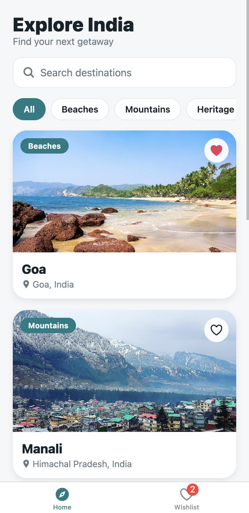
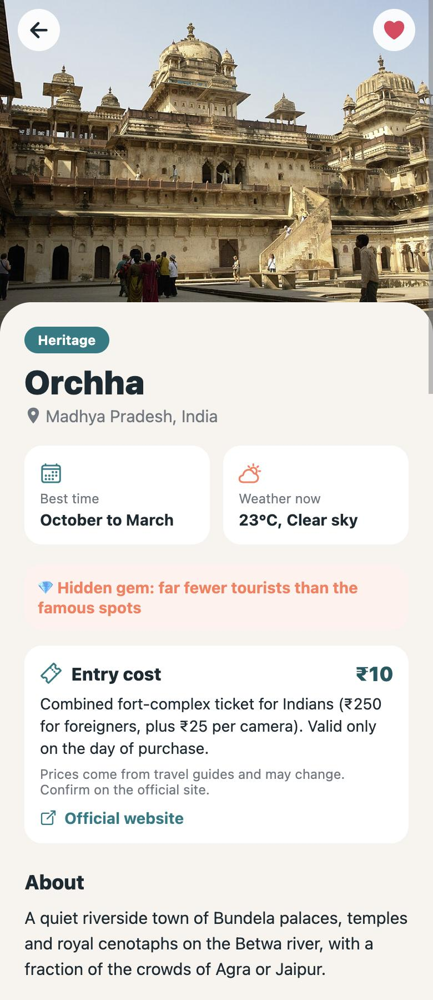
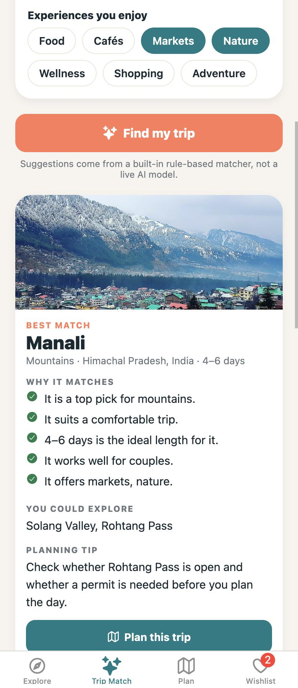
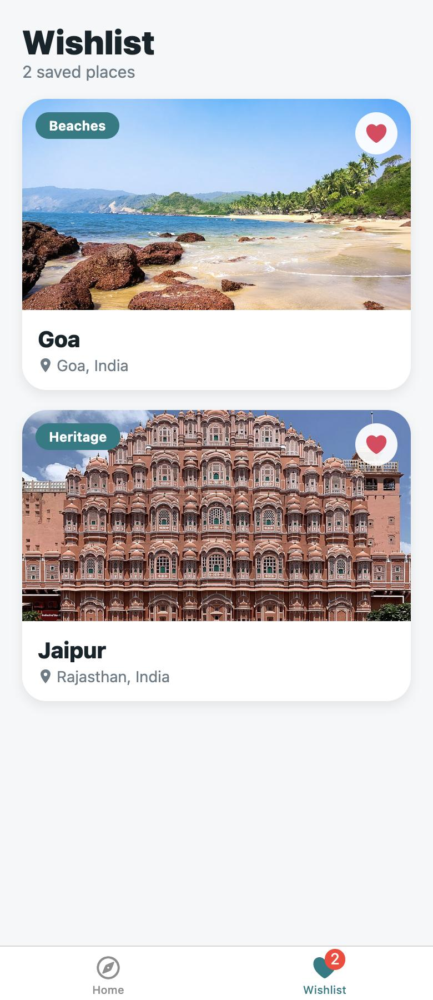
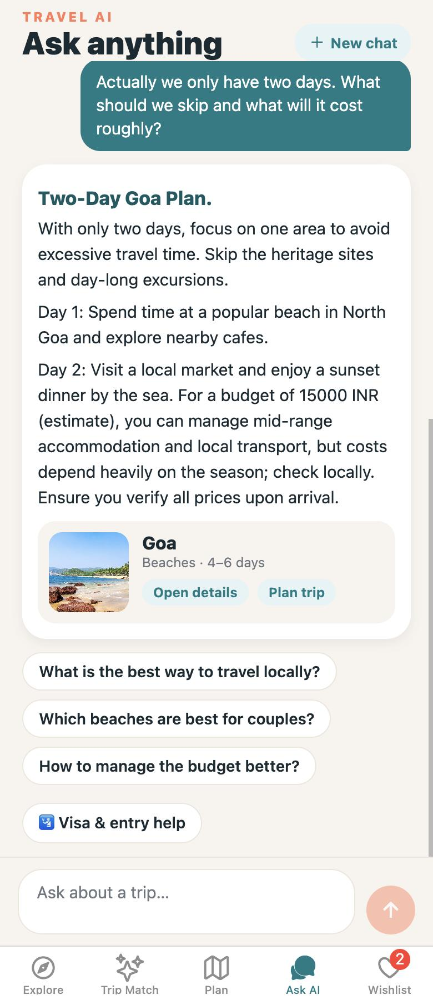
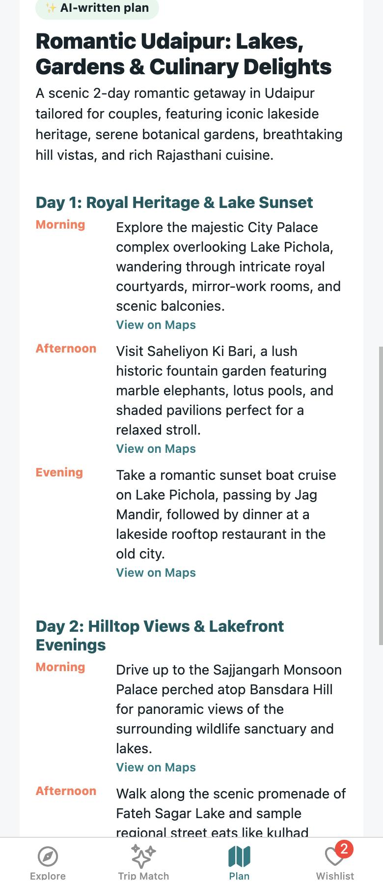
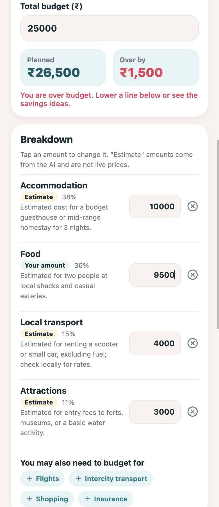

# Roam India: Travel Explorer + AI Travel Companion

A React Native (Expo, TypeScript) app for discovering destinations across India, including lesser-known "hidden gems", with an AI travel concierge, an editable AI itinerary builder, an AI-assisted budget planner and a personalised Trip Match. Built for the GDGC VNRVJIET App Development assignment.

The language model gives intelligence and personalisation. The app's own code does validation, calculations, navigation and storage. The AI never books anything.

## Tech stack

- React Native with Expo (TypeScript), React Navigation (bottom tabs + stack), AsyncStorage
- A small dependency-free Node server (`server/`) that calls the Google **Gemini** API, so the API key never ships inside the app
- Open-Meteo (free, no key) for live weather
- Static local destination data for 15 places

## Features

### Core assignment (no AI needed)
| Stage | Implemented |
|-------|-------------|
| 1. Discovery | 15 destinations across Beaches, Mountains, Heritage and Adventure (including wildlife); image, name, location, category and a wishlist heart on every card |
| 2. Navigation & details | Tabs plus a Details screen: hero image, description, best time, 2–3 attractions with images, nearby experiences, Google Maps links |
| 3. Search & filtering | Case-insensitive name search + category chips + "All", combined; clear, reset and empty states |
| 4. Wishlist | Add/remove, no duplicates, live updates everywhere, empty state with an action, persisted across restarts |
| Extras | Hidden gems with entry cost and official links, price filters, personal notes, live weather with loading/unavailable states, image fallbacks |

### AI features (Gemini)
| Feature | What it does | Rule-based fallback |
|---------|--------------|---------------------|
| **Travel AI** (Ask AI tab) | Chat that remembers the active trip (destination, days, budget, travellers, itinerary); follow-ups, suggestion chips, destination cards, "New chat", retry | Clear error + the rest of the app keeps working |
| **Trip Match** | The app's rule-based engine shortlists destinations; Gemini explains why each fits *this* traveller and names a trade-off. Optional starting city, month and dietary/accessibility notes | Rule-based results shown alone, labelled "Rule-based result" |
| **Itinerary builder** (Plan tab) | Day-by-day plan with morning/afternoon/evening, meal and café ideas, rest time, transport notes, rough costs, alternatives and booking reminders | Labelled "Offline plan (not AI)" for places in the app |
| **Editable itinerary** | Remove or replace an activity, regenerate one day, "Lower budget", "More relaxed", "More adventurous", "Explain choices", add an attraction from a destination page | Remove always works; AI edits need the AI |
| **Budget planner** | Describe a budget in plain words; the AI suggests an editable split; **the app adds up the totals**, shows what is left or over, and flags each line as "Estimate" or "Your amount" | Needs the AI |
| **Research + sources** | Visa/entry rules, advisories, exchange rates, opening hours and similar are sent through Google Search grounding; source links returned by the API are shown (see limits below) | If research fails the answer is clearly marked **not verified** |
| **Visa & entry help** | A short form (nationality, destination, purpose, dates) that asks for official requirements. It never assumes nationality and never collects passport numbers | Same as research |

## Architecture

```
Mobile app (Expo)  ──HTTP──▶  server/index.js  ──HTTPS──▶  Gemini API
 screens, state,               validates input, rate-limits,    structured JSON,
 validation,                   caches, picks a model,           optional Google Search
 budget maths,                 validates the reply              grounding
 local storage                 (holds GEMINI_API_KEY)
```

- **Key safety:** the key lives only in the server's environment (`.env`, git-ignored). It is sent to Google in a header and never logged, returned or placed in the app.
- **Structured output:** every AI answer (chat, match, itinerary, budget) is requested as JSON with a schema, then validated **twice** (server, then app). Invented destination IDs are dropped, numbers are range-checked, day counts and enums are enforced, and malformed output is rejected with a friendly error.
- **Deterministic code does the maths:** budget totals, remaining money, per-day itinerary costs and percentages are computed in `src/utils/budget.ts`, never by the model.
- **Context:** only what is needed is sent (destination, days, budget level, travellers, interests, a short itinerary summary). Nothing personal is sent, and passport details are never collected.
- **Models:** the server tries several Gemini models in order and skips ones that are out of daily quota or busy (free-tier quotas are per model per day).
- **Grounding vs JSON:** search-grounded answers are returned as text plus sources (grounding and structured output are not combined, because that pairing is a preview feature).

### Research and citation workflow
Questions that depend on current facts (visa, entry requirements, advisories, exchange rates, opening hours, prices, permits) are detected by the server and sent with Google Search grounding. The app shows the **source links the API actually returns** (http/https links only, de-duplicated, never invented) under "Sources · found with Google Search". If research is unavailable, the answer is shown with a "not verified, check the official source" banner and no sources. Official government sites are preferred in the prompt for visa questions.

## Setup

Requires Node.js 24 (or 22.18+): the server loads `.env` and the tests run TypeScript directly.

```bash
cd travel-explorer-app      # npm commands only work inside the project folder
npm install
cp .env.example .env        # then paste your Gemini API key into .env

# terminal 1: AI server
npm run server

# terminal 2: the app
npx expo start --web        # or press i / a, or scan the QR code with Expo Go

# macOS/Linux shortcut: start both together
npm run dev
```

On a physical phone `localhost` points at the phone, so use your computer's address: `EXPO_PUBLIC_API_URL=http://<your-computer-ip>:8787 npx expo start` (Android emulator: `http://10.0.2.2:8787`). Expo Go must support this project's Expo SDK (58).

### Environment variables (server only, in `.env`)
| Variable | Purpose |
|----------|---------|
| `GEMINI_API_KEY` | Required for AI features. Free key: [Google AI Studio](https://aistudio.google.com/apikey) |
| `GEMINI_MODEL` | Optional model to try first |
| `GEMINI_THINKING_BUDGET` | Optional, default `0` (thinking off) |
| `RATE_LIMIT_PER_MIN` | Optional, default 20 AI requests per IP per minute |
| `EXPO_PUBLIC_API_URL` | App only: where the server is. Contains no secret |

## Testing

```bash
npm test          # 35 automated tests
npx tsc --noEmit  # type check
```

The tests (`tests/`) run with no network and no API key, against a mock Gemini endpoint. They cover: structured output and validation, invented destination IDs being dropped, wrong day counts and malformed output being rejected, number/enum sanitising, grounding on and off, source URL validation (`javascript:` links dropped), the "unverified" fallback, quota and busy handling, model fallback and cooldown, request limits and rate limiting, the key never appearing in a request body or error, budget arithmetic, and a rendering regression. They do **not** prove the real model's answer quality.

Also checked by hand in the web build against the real Gemini API: chat with a follow-up that kept the trip context, itinerary generation, removing an activity (totals follow), regenerating one day, "Explain choices", the budget planner (typed amount wins over saved trip data; editing a line recalculates), Trip Match explanations, the server being switched off (clear error, retry, rest of the app unaffected), and the original search, filters, wishlist persistence, weather and Maps links.

## Security and cost

- Server-side key, `.env` git-ignored, `.env.example` has placeholders only, no key in git history.
- Request size limit (60 KB), per-IP rate limit, whitelisted request fields, input length caps, timeouts, bounded output sizes.
- No automatic retry storms: each model is tried once per request; models out of quota are skipped for hours. Identical requests (match, itinerary, budget, explain) are served from a short in-memory cache.
- Request bodies, messages and keys are never logged; the server logs only method, path, status and time.
- **Billing/limits:** the free tier has small per-model daily request limits. When they are used up the app shows "usage limit" and keeps working offline. Search grounding is billed separately by Google and may be unavailable on a free key.

## Limitations and known issues

- **Google Search grounding was not available on the key used for development** (every request returned a quota error), so the live research path has only been tested against a mock that mimics the API's `groundingMetadata`. With a plan that includes grounding it should return real sources, but that is unverified. Without it the app falls back to an answer marked "not verified".
- **Free-tier quota:** daily request limits per model were reached during testing. The server falls through to other models, but if all are exhausted AI features pause until the quota resets.
- **Gemini models are sometimes overloaded** (503) or slow. Replies usually take 5–20 seconds.
- AI answers can be wrong. Prices, durations and costs are estimates, never quotes. No live flight, hotel, currency-counter or reservation data is connected, and no exchange rates are shown.
- Visa answers are guidance, not legal advice. Always confirm on the destination government's official website.
- Hidden-gem ticket prices were taken from travel guides, not official sources, and may be out of date.
- The offline plan only covers the app's own 15 destinations.
- Verified in the web build only, not on a physical phone or emulator.
- Not built: flight or hotel search, bookings or payments, a live currency converter, passport-document handling.

## Project structure

```
server/
  index.js        routes, input validation, rate limit, cache, research decision
  gemini.js       Gemini client: models, quota cooldown, grounding sources, errors
  schemas.js      Gemini JSON schemas + the validators that gate every reply
  prompts.js      system prompts and safety rules
src/
  services/ai.ts          app-side API client (dedupe, timeouts, error codes)
  services/validate.ts    app-side validation of every AI reply
  services/itinerary.ts   itinerary types + the offline plan
  context/TripContext     active trip, itinerary, conversation (saved on device)
  context/WishlistContext wishlist + notes (saved on device)
  utils/budget.ts         all budget and itinerary-cost arithmetic
  utils/matcher.ts        rule-based Trip Match scoring
  screens/                Home, Details, Wishlist, TripMatch, Planner, Concierge, Budget
  components/             cards, chips, RichText, DestinationInput, SafeImage...
  data/                   destinations and trip-planning metadata
tests/                    server, budget and rendering tests
```

## Screenshots

| Explore | Details | Trip Match | Wishlist |
|---------|---------|------------|----------|
|  |  |  |  |

| Travel AI chat | Editable itinerary | Budget planner |
|----------------|--------------------|----------------|
|  |  |  |
